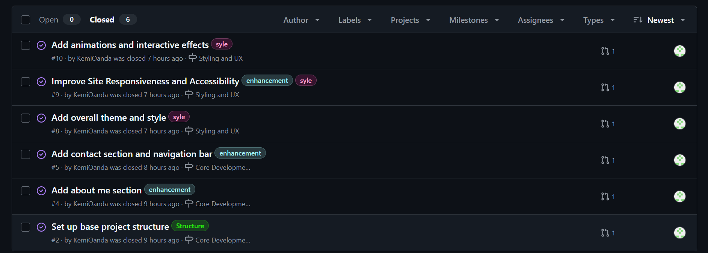
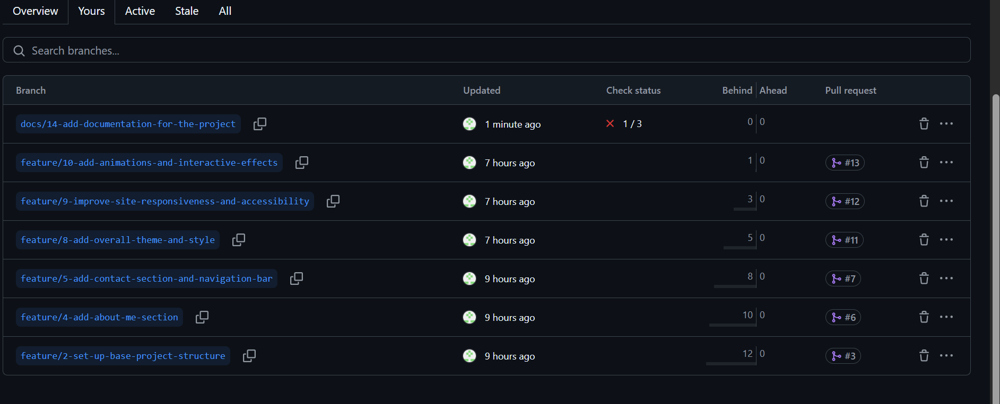

# Personal Portfolio Documentation

## 1. Student Details

- **Full Name**: Oanda Michelle Kemunto Nyatero
- **GitHub Username**:KemiOanda
- **Email**:nyaterooanda@gmail.com / michelle.oanda@strathmore.edu

## 2. Deployed Portfolio Link

- **GitHub Pages URL**:  
 https://is-project-4th-year.github.io/build-your-portfolio-github-workflow-essentials-KemiOanda/

## 3. Learnings from the Git Crash Program
Below are some of the key concepts and skills I gained and how they helped me manage my portfolio project more effectively:

- **Issue Management**: Helped me organize tasks, bugs, and feature requests in a clear and trackable way, improving overall project structure.
- **Labels**: Using labels like `bug`, `feature`, and `refactor` made it easier to categorize tasks. Creating custom labels such as `team profile` improved clarity and communication.
- **Milestones and Project Boards**: Enabled me to visually track progress using workflows like "To Do," "In Progress," and "Done," which enhanced planning and accountability.
- **Branch Naming and Traceability**: Naming branches using issue numbers and short descriptions (e.g., `feature/12-add-login`) helped keep work organized and directly connected to tasks.
- **Pull Requests**: Allowed me to propose changes, get feedback, and merge code with confidence, which improved collaboration and code quality.
- **Merge Conflict Resolution**: Taught me how to handle code conflicts when multiple people work on the same files, a crucial skill in team environments.
- **Commit Messages**: Practicing meaningful commit messages helped keep the project history clean and made it easier to understand the purpose of each change.

Overall, these skills have equipped me to collaborate effectively in modern software development projects using GitHub.

## 4. Screenshots of Key GitHub Features

Include screenshots that demonstrate how you used GitHub to manage your project. For each screenshot, write a short caption explaining what it shows.

> Upload the screenshots to your GitHub repository and reference them here using Markdown image syntax:
> (you could just simply copy and paste the image into the Assignment.md)

```markdown

```

### A. Milestones and Issues

- Screenshot showing your milestone(s) and the issues linked to it.



### B. Project Board

- Screenshot of your GitHub Project Board with issues organized into columns (e.g., To Do, In Progress, Done).


### C. Branching

- Screenshot showing your branch list with meaningful naming.


### D. Pull Requests

- Screenshot of a pull request that’s either open or merged and linked to a related issue.


### E. Merge Conflict Resolution

- Screenshot of a resolved merge conflict (in a pull request, commit history, or your local terminal/GitHub Desktop).
